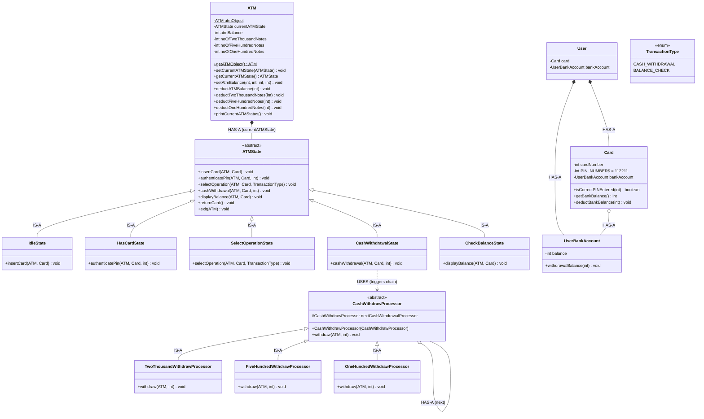

# ATM System - Low Level Design & Architecture

## 1. Overview
The **ATM System** coordinates cash withdrawals, user authentication, and balance checking using hardware states and note dispensing chains.

---

## 2. Design Patterns Used
1. **State Pattern**:
   - `ATM` (Context) delegates actions to `ATMState`. Concrete states (`IdleState`, `HasCardState`, `SelectOperationState`, `CashWithdrawalState`, `CheckBalanceState`) handle state-specific logic and transitions.
2. **Chain of Responsibility Pattern**:
   - `CashWithdrawProcessor` chains note handlers (`TwoThousandWithdrawProcessor` $\rightarrow$ `FiveHundredWithdrawProcessor` $\rightarrow$ `OneHundredWithdrawProcessor`) to dispense currency notes in decreasing denominations.
3. **Singleton Pattern**:
   - `ATM` uses eager initialization with `getATMObject()` to manage hardware cash inventory globally.

---

## 3. Relationships Summary (IS-A & HAS-A)

### IS-A (Inheritance / Realization)
- `IdleState` **IS-A** `ATMState` (`extends ATMState`)
- `HasCardState` **IS-A** `ATMState` (`extends ATMState`)
- `SelectOperationState` **IS-A** `ATMState` (`extends ATMState`)
- `CashWithdrawalState` **IS-A** `ATMState` (`extends ATMState`)
- `CheckBalanceState` **IS-A** `ATMState` (`extends ATMState`)
- `TwoThousandWithdrawProcessor` **IS-A** `CashWithdrawProcessor` (`extends CashWithdrawProcessor`)
- `FiveHundredWithdrawProcessor` **IS-A** `CashWithdrawProcessor` (`extends CashWithdrawProcessor`)
- `OneHundredWithdrawProcessor` **IS-A** `CashWithdrawProcessor` (`extends CashWithdrawProcessor`)

### HAS-A (Composition & Association)
- `ATM` **HAS-A** `ATMState` (`currentATMState`)
- `ATM` **HAS-A** Note inventory counters (`noOfTwoThousandNotes`, etc.)
- `User` **HAS-A** `Card` (`card`)
- `User` **HAS-A** `UserBankAccount` (`bankAccount`)
- `Card` **HAS-A** `UserBankAccount` (`bankAccount`)
- `CashWithdrawProcessor` **HAS-A** `CashWithdrawProcessor` (`nextCashWithdrawalProcessor` chain link)
- `CashWithdrawalState` **HAS-A** dependency on `CashWithdrawProcessor` (invokes chain)

---

## 4. Mermaid UML Class Diagram

