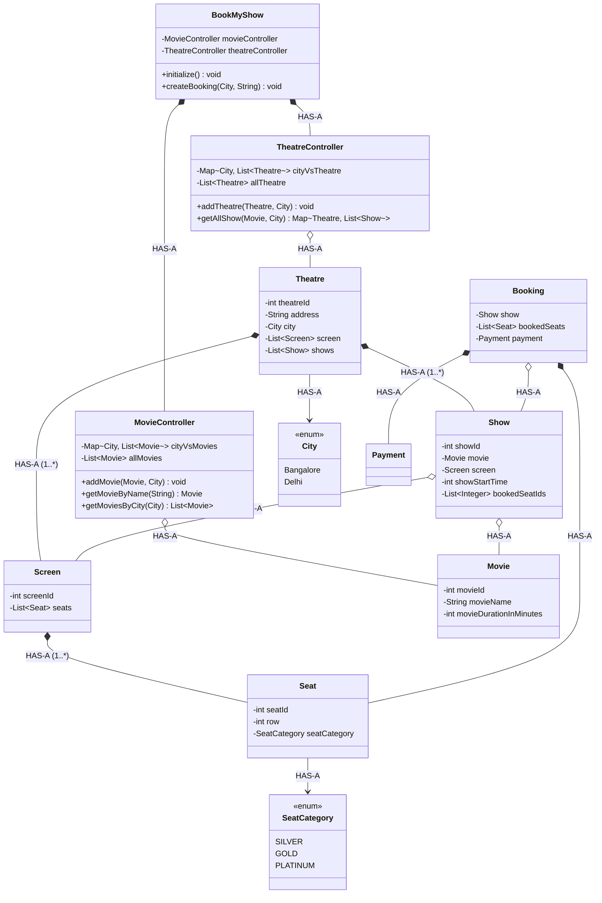

# BookMyShow - Low Level Design & Architecture

## 1. Overview
Online cinema ticketing architecture coordinating cities, theatres, auditoriums (screens), shows, and seat allocations.

---

## 2. Design Patterns Used
1. **Controller / Repository Pattern**: `MovieController` and `TheatreController` manage collections of domain models indexed by geographical location (`City`).
2. **Facade Pattern**: `BookMyShow` orchestrates movie lookup, show schedule queries, and seat reservations through controllers.

---

## 3. Relationships Summary (IS-A & HAS-A)

### IS-A (Inheritance / Realization)
- In this design, domain entities are concrete POJOs without deep class inheritance trees.
- `City` and `SeatCategory` are typed enums.

### HAS-A (Composition & Association)
- `BookMyShow` **HAS-A** `MovieController` (`movieController`)
- `BookMyShow` **HAS-A** `TheatreController` (`theatreController`)
- `TheatreController` **HAS-A** `Map<City, List<Theatre>>`
- `MovieController` **HAS-A** `Map<City, List<Movie>>`
- `Theatre` **HAS-A** `List<Screen>` (Composition: 1 Theatre has many Screens)
- `Theatre` **HAS-A** `List<Show>` (Composition: 1 Theatre runs many Shows)
- `Theatre` **HAS-A** `City` (Association: located in a City)
- `Screen` **HAS-A** `List<Seat>` (Composition: 1 Screen has many Seats)
- `Seat` **HAS-A** `SeatCategory` (Association: `SILVER`, `GOLD`, `PLATINUM`)
- `Show` **HAS-A** `Movie` (Association: Show plays a Movie)
- `Show` **HAS-A** `Screen` (Association: Show runs on a Screen)
- `Show` **HAS-A** `List<Integer>` (`bookedSeatIds`)
- `Booking` **HAS-A** `Show` (`show`)
- `Booking` **HAS-A** `List<Seat>` (`bookedSeats`)
- `Booking` **HAS-A** `Payment` (`payment`)

---

## 4. Mermaid UML Class Diagram

