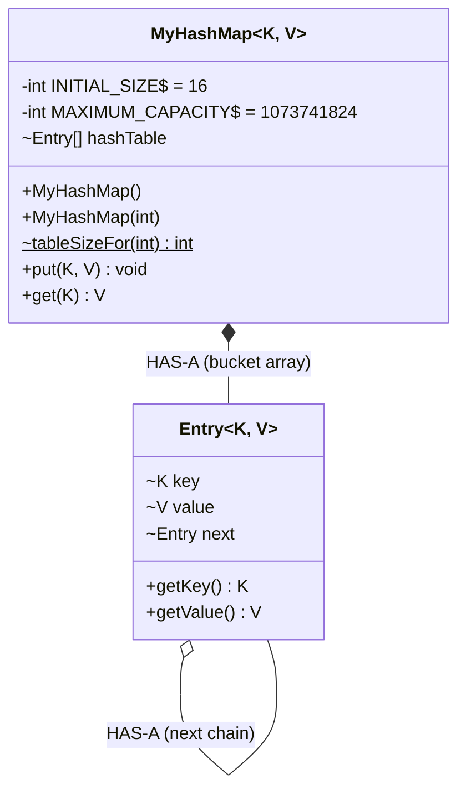

# Custom HashMap Data Structure - Low Level Design & Architecture

## 1. Overview
Custom generic hash map with power-of-two table sizing and collision resolution using separate chaining (linked list).

---

## 2. Design Patterns Used
1. **Separate Chaining (Collision Resolution)**: Singly-linked list node chains inside bucket array.

---

## 3. Relationships Summary (IS-A & HAS-A)

### IS-A (Inheritance / Realization)
- Standalone generic class without inheritance hierarchy.

### HAS-A (Composition & Association)
- `MyHashMap` **HAS-A** `Entry[]` (`hashTable` bucket array)
- `Entry` **HAS-A** `Entry` (`next` pointer forming singly-linked list)
- `Entry` holds generic key `K` and value `V`

---

## 4. Mermaid UML Class Diagram

