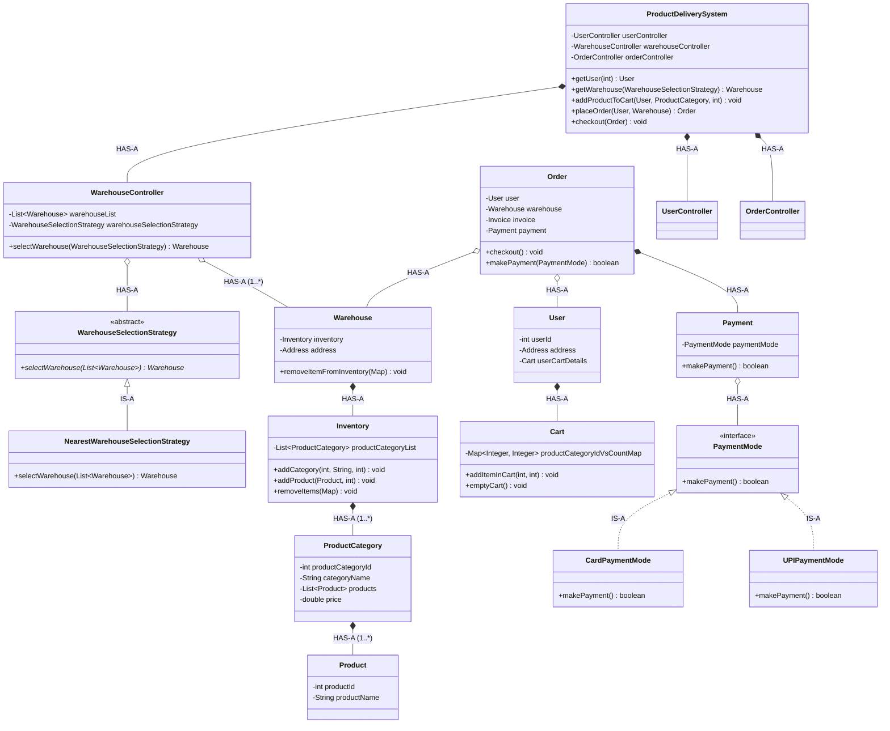

# Order Management & Delivery System - Low Level Design & Architecture

## 1. Overview
Retail order fulfillment pipeline modeling customer carts, warehouse inventory, order placement, dynamic warehouse fulfillment, and payment execution.

---

## 2. Design Patterns Used
1. **Facade Pattern**: `ProductDeliverySystem` provides a single entry point hiding `UserController`, `WarehouseController`, and `OrderController`.
2. **Strategy Pattern (Warehouse Routing)**: `WarehouseSelectionStrategy` defines fulfillment routing algorithms (e.g. `NearestWarehouseSelectionStrategy`).
3. **Strategy Pattern (Payment Methods)**: `PaymentMode` interface implemented by `CardPaymentMode` and `UPIPaymentMode`.

---

## 3. Relationships Summary (IS-A & HAS-A)

### IS-A (Inheritance / Realization)
- `NearestWarehouseSelectionStrategy` **IS-A** `WarehouseSelectionStrategy` (`extends WarehouseSelectionStrategy`)
- `CardPaymentMode` **IS-A** `PaymentMode` (`implements PaymentMode`)
- `UPIPaymentMode` **IS-A** `PaymentMode` (`implements PaymentMode`)

### HAS-A (Composition & Association)
- `ProductDeliverySystem` **HAS-A** `UserController` (`userController`)
- `ProductDeliverySystem` **HAS-A** `WarehouseController` (`warehouseController`)
- `ProductDeliverySystem` **HAS-A** `OrderController` (`orderController`)
- `WarehouseController` **HAS-A** `List<Warehouse>` (`warehouseList`)
- `WarehouseController` **HAS-A** `WarehouseSelectionStrategy` (`warehouseSelectionStrategy`)
- `Warehouse` **HAS-A** `Inventory` (`inventory`)
- `Warehouse` **HAS-A** `Address` (`address`)
- `Inventory` **HAS-A** `List<ProductCategory>` (`productCategoryList`)
- `ProductCategory` **HAS-A** `List<Product>` (`products`)
- `User` **HAS-A** `Cart` (`userCartDetails`)
- `User` **HAS-A** `Address` (`address`)
- `Order` **HAS-A** `User` (`user`)
- `Order` **HAS-A** `Warehouse` (`warehouse`)
- `Order` **HAS-A** `Invoice` (`invoice`)
- `Order` **HAS-A** `Payment` (`payment`)
- `Payment` **HAS-A** `PaymentMode` (`paymentMode`)

---

## 4. Mermaid UML Class Diagram

