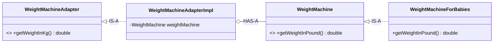
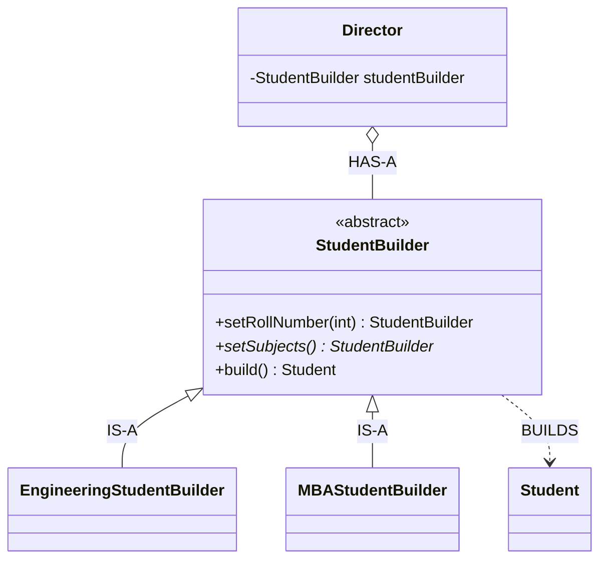
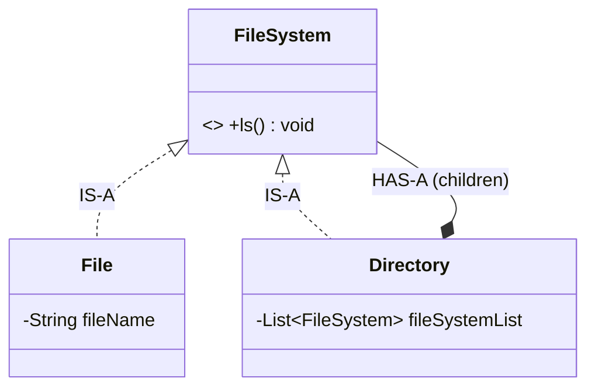
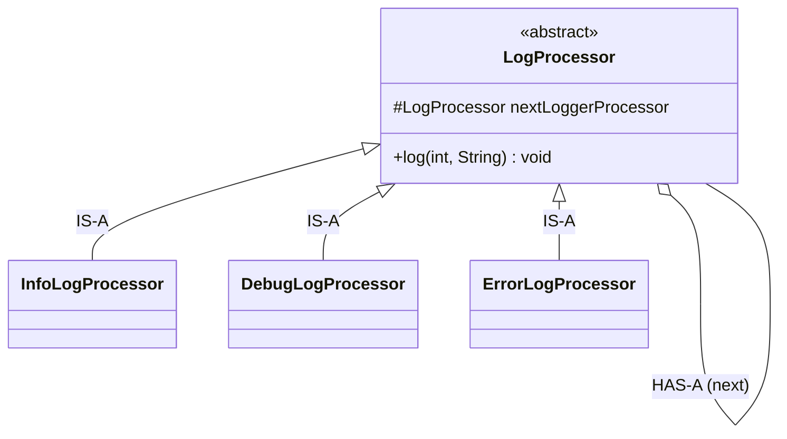

# GoF Design Patterns - Low Level Design & Architecture

## 1. Overview
Reference implementations of 5 classic Gang of Four (GoF) design patterns:
1. **Adapter Pattern** (Structural)
2. **Builder Pattern** (Creational)
3. **Composite Pattern** (Structural)
4. **Flyweight Pattern** (Structural)
5. **Chain of Responsibility Pattern** (Behavioral)

---

## 2. Relationships Summary (IS-A & HAS-A)

### A. Adapter Pattern
- **IS-A**:
  - `WeightMachineForBabies` **IS-A** `WeightMachine` (`implements WeightMachine`)
  - `WeightMachineAdapterImpl` **IS-A** `WeightMachineAdapter` (`implements WeightMachineAdapter`)
- **HAS-A**:
  - `WeightMachineAdapterImpl` **HAS-A** `WeightMachine` (`weightMachine`)

### B. Builder Pattern
- **IS-A**:
  - `EngineeringStudentBuilder` **IS-A** `StudentBuilder` (`extends StudentBuilder`)
  - `MBAStudentBuilder` **IS-A** `StudentBuilder` (`extends StudentBuilder`)
- **HAS-A**:
  - `Director` **HAS-A** `StudentBuilder` (`studentBuilder`)
  - `StudentBuilder` builds and returns `Student`

### C. Composite Pattern
- **IS-A**:
  - `File` **IS-A** `FileSystem` (`implements FileSystem`)
  - `Directory` **IS-A** `FileSystem` (`implements FileSystem`)
  - `Number` **IS-A** `ArithmeticExpression` (`implements ArithmeticExpression`)
  - `Expression` **IS-A** `ArithmeticExpression` (`implements ArithmeticExpression`)
- **HAS-A**:
  - `Directory` **HAS-A** `List<FileSystem>` (Composite has list of components)
  - `Expression` **HAS-A** `ArithmeticExpression` (left and right children)

### D. Flyweight Pattern
- **IS-A**:
  - `HumanoidRobot` **IS-A** `IRobot` (`implements IRobot`)
  - `RoboticDog` **IS-A** `IRobot` (`implements IRobot`)
- **HAS-A**:
  - `HumanoidRobot` and `RoboticDog` **HAS-A** `Sprites` (shared intrinsic bitmap)
  - `RoboticFactory` **HAS-A** cache of `IRobot` instances

### E. Chain of Responsibility Pattern
- **IS-A**:
  - `InfoLogProcessor` **IS-A** `LogProcessor` (`extends LogProcessor`)
  - `DebugLogProcessor` **IS-A** `LogProcessor` (`extends LogProcessor`)
  - `ErrorLogProcessor` **IS-A** `LogProcessor` (`extends LogProcessor`)
- **HAS-A**:
  - `LogProcessor` **HAS-A** `LogProcessor` (`nextLoggerProcessor` link in chain)

---

## 3. Mermaid UML Class Diagrams

### Adapter Pattern

### Builder Pattern

### Composite Pattern

### Chain of Responsibility Pattern

