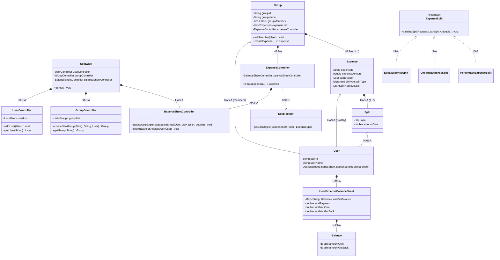

# Splitwise - Low Level Design & Architecture

## 1. Overview
Shared expense tracking and settling platform with automatic reciprocal balance calculation across users and groups.

---

## 2. Design Patterns Used
1. **Strategy Pattern**:
   - `ExpenseSplit` interface implemented by `EqualExpenseSplit`, `UnequalExpenseSplit`, and `PercentageExpenseSplit` to validate split calculations dynamically.
2. **Factory Pattern**:
   - `SplitFactory` instantiates the appropriate `ExpenseSplit` strategy based on `ExpenseSplitType`.
3. **Facade Pattern**:
   - `Splitwise` class unifies user, group, and balance sheet controllers.

---

## 3. Relationships Summary (IS-A & HAS-A)

### IS-A (Inheritance / Realization)
- `EqualExpenseSplit` **IS-A** `ExpenseSplit` (`implements ExpenseSplit`)
- `UnequalExpenseSplit` **IS-A** `ExpenseSplit` (`implements ExpenseSplit`)
- `PercentageExpenseSplit` **IS-A** `ExpenseSplit` (`implements ExpenseSplit`)

### HAS-A (Composition & Association)
- `Splitwise` **HAS-A** `UserController` (`userController`)
- `Splitwise` **HAS-A** `GroupController` (`groupController`)
- `Splitwise` **HAS-A** `BalanceSheetController` (`balanceSheetController`)
- `UserController` **HAS-A** `List<User>` (`userList`)
- `GroupController` **HAS-A** `List<Group>` (`groupList`)
- `Group` **HAS-A** `List<User>` (`groupMembers`)
- `Group` **HAS-A** `List<Expense>` (`expenseList`)
- `Group` **HAS-A** `ExpenseController` (`expenseController`)
- `ExpenseController` **HAS-A** `BalanceSheetController` (`balanceSheetController`)
- `ExpenseController` **USES** `SplitFactory`
- `Expense` **HAS-A** `User` (`paidByUser`)
- `Expense` **HAS-A** `List<Split>` (`splitDetails`)
- `Expense` **HAS-A** `ExpenseSplitType` (`splitType`)
- `Split` **HAS-A** `User` (`user`)
- `User` **HAS-A** `UserExpenseBalanceSheet` (`userExpenseBalanceSheet`)
- `UserExpenseBalanceSheet` **HAS-A** `Map<String, Balance>` (`userVsBalance`)

---

## 4. Mermaid UML Class Diagram

