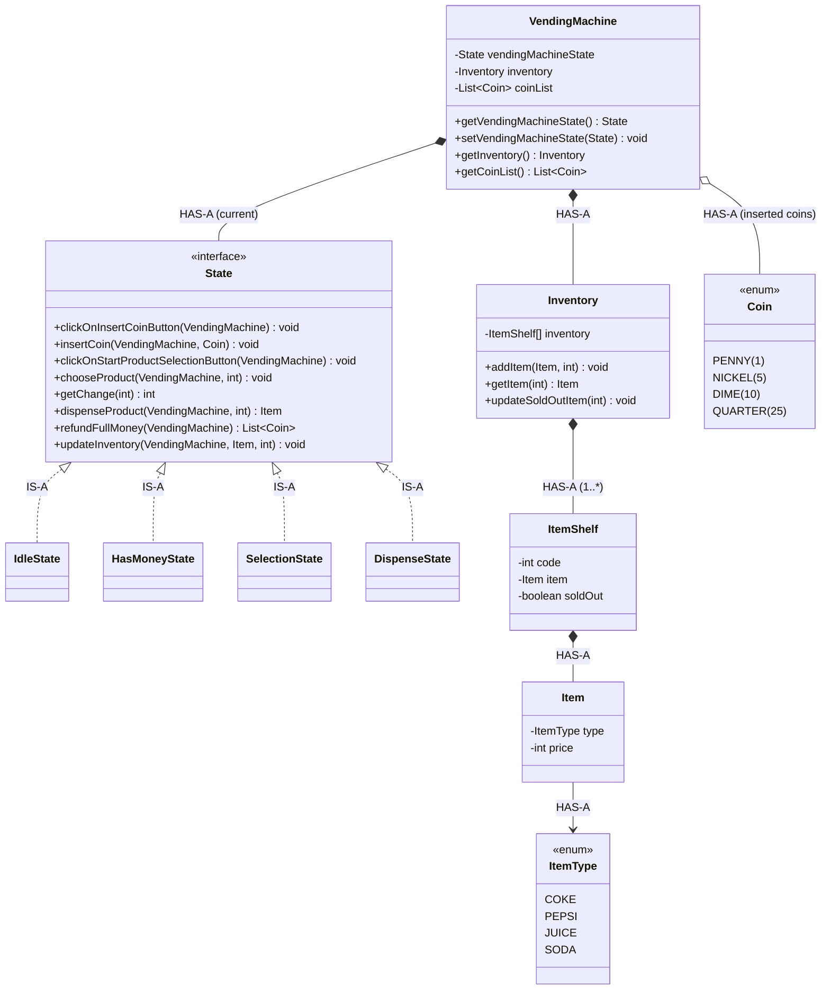

# Vending Machine - Low Level Design & Architecture

## 1. Overview
Automated vending machine dispensing beverages, evaluating coin denominations, calculating change, and managing state transitions.

---

## 2. Design Patterns Used
1. **State Pattern**:
   - `VendingMachine` (Context) maintains an active `State` reference.
   - Operations delegate to `State` (`IdleState`, `HasMoneyState`, `SelectionState`, `DispenseState`).
   - Prevents invalid customer actions (e.g., selecting an item before inserting money).

---

## 3. Relationships Summary (IS-A & HAS-A)

### IS-A (Inheritance / Realization)
- `IdleState` **IS-A** `State` (`implements State`)
- `HasMoneyState` **IS-A** `State` (`implements State`)
- `SelectionState` **IS-A** `State` (`implements State`)
- `DispenseState` **IS-A** `State` (`implements State`)

### HAS-A (Composition & Association)
- `VendingMachine` **HAS-A** `State` (`vendingMachineState`)
- `VendingMachine` **HAS-A** `Inventory` (`inventory`)
- `VendingMachine` **HAS-A** `List<Coin>` (`coinList`)
- `Inventory` **HAS-A** `ItemShelf[]` (array of shelves)
- `ItemShelf` **HAS-A** `Item` (`item`)
- `Item` **HAS-A** `ItemType` (`type`)
- All concrete state implementations accept `VendingMachine` as method arguments (Dependency / Association).

---

## 4. Mermaid UML Class Diagram

