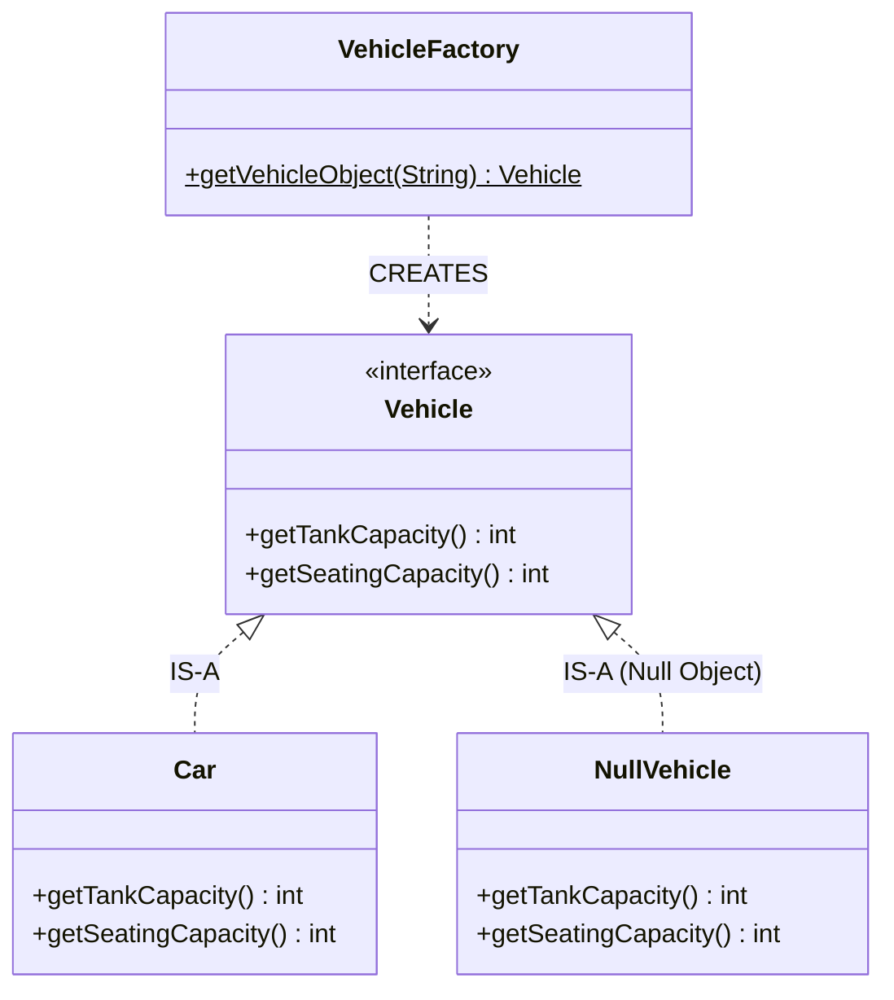

# Null Object Pattern - Low Level Design & Architecture

## 1. Overview
Eliminates null checking boilerplate (`if (obj != null)`) by returning a polymorphic neutral object that implements the standard interface.

---

## 2. Design Patterns Used
1. **Null Object Pattern**: `NullVehicle` implements `Vehicle` providing zero values instead of returning `null`.
2. **Simple Factory Pattern**: `VehicleFactory` encapsulates object creation.

---

## 3. Relationships Summary (IS-A & HAS-A)

### IS-A (Inheritance / Realization)
- `Car` **IS-A** `Vehicle` (`implements Vehicle`)
- `NullVehicle` **IS-A** `Vehicle` (`implements Vehicle`)

### HAS-A (Composition & Association)
- `VehicleFactory` creates and returns `Vehicle` (Factory association)
- `Main` uses `VehicleFactory` and `Vehicle`

---

## 4. Mermaid UML Class Diagram

