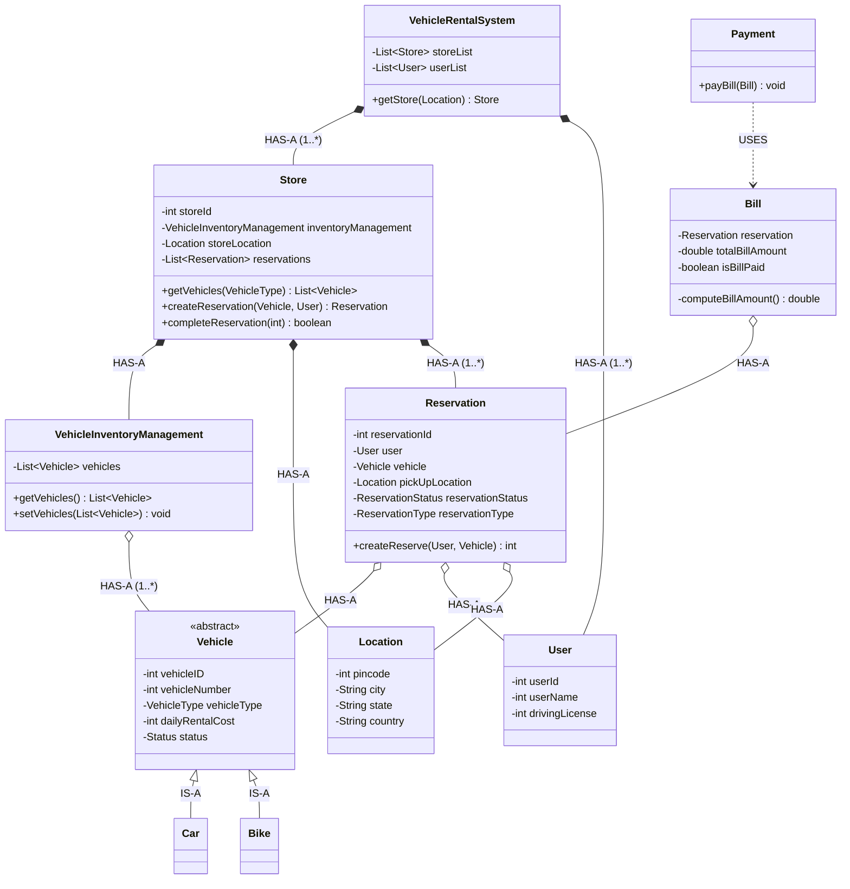

# Car Rental System - Low Level Design & Architecture

## 1. Overview
Automobile and bike reservation platform managing stores, inventory lists, reservation lifecycles, and billing.

---

## 2. Design Patterns Used
1. **Polymorphic Hierarchy**: Abstract class `Vehicle` extended by `Car` and `Bike` allows unified rental pricing calculations and inventory filtering.
2. **Facade Pattern**: `VehicleRentalSystem` coordinates store search by location and customer lists.

---

## 3. Relationships Summary (IS-A & HAS-A)

### IS-A (Inheritance / Realization)
- `Car` **IS-A** `Vehicle` (`extends Vehicle`)
- `Bike` **IS-A** `Vehicle` (`extends Vehicle`)

### HAS-A (Composition & Association)
- `VehicleRentalSystem` **HAS-A** `List<Store>` (`storeList`)
- `VehicleRentalSystem` **HAS-A** `List<User>` (`userList`)
- `Store` **HAS-A** `VehicleInventoryManagement` (`inventoryManagement`)
- `Store` **HAS-A** `Location` (`storeLocation`)
- `Store` **HAS-A** `List<Reservation>` (`reservations`)
- `VehicleInventoryManagement` **HAS-A** `List<Vehicle>` (`vehicles`)
- `Reservation` **HAS-A** `User` (`user`)
- `Reservation` **HAS-A** `Vehicle` (`vehicle`)
- `Reservation` **HAS-A** `Location` (`pickUpLocation`, `dropLocation`)
- `Reservation` **HAS-A** `ReservationStatus` (`reservationStatus`)
- `Reservation` **HAS-A** `ReservationType` (`reservationType`)
- `Bill` **HAS-A** `Reservation` (`reservation`)
- `Payment` **USES** `Bill` (Dependency)
- `PaymentDetails` **HAS-A** `PaymentMode` (`paymentMode`)

---

## 4. Mermaid UML Class Diagram

