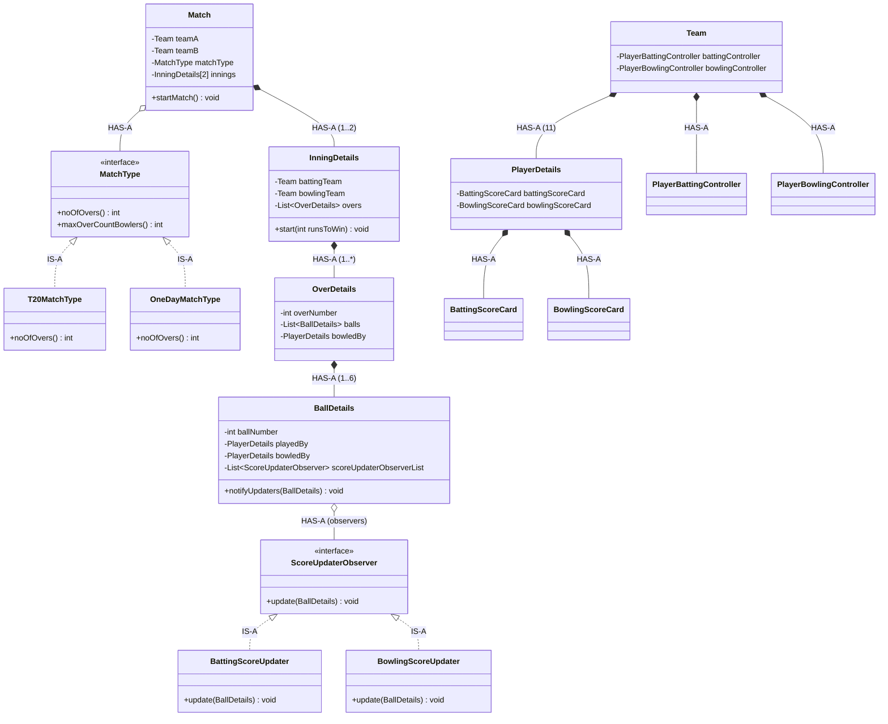

# Cricbuzz Match & Live Scoring - Low Level Design & Architecture

## 1. Overview
Cricket match simulator with ball-by-ball updates, live scorecard listeners, and batting/bowling rotation controllers.

---

## 2. Design Patterns Used
1. **Observer Pattern**:
   - `BallDetails` (Subject) maintains a list of `ScoreUpdaterObserver` instances.
   - `BattingScoreUpdater` and `BowlingScoreUpdater` (Observers) receive delivery events and update respective statistics.
2. **Strategy Pattern**:
   - `MatchType` interface defines overs and bowler limits (`T20MatchType`, `OneDayMatchType`).
3. **Controller Pattern**:
   - `PlayerBattingController` and `PlayerBowlingController` manage lineup queues and rotation constraints.

---

## 3. Relationships Summary (IS-A & HAS-A)

### IS-A (Inheritance / Realization)
- `T20MatchType` **IS-A** `MatchType` (`implements MatchType`)
- `OneDayMatchType` **IS-A** `MatchType` (`implements MatchType`)
- `BattingScoreUpdater` **IS-A** `ScoreUpdaterObserver` (`implements ScoreUpdaterObserver`)
- `BowlingScoreUpdater` **IS-A** `ScoreUpdaterObserver` (`implements ScoreUpdaterObserver`)

### HAS-A (Composition & Association)
- `Match` **HAS-A** `Team` (`teamA`, `teamB`)
- `Match` **HAS-A** `MatchType` (`matchType`)
- `Match` **HAS-A** `InningDetails[2]` (`innings`)
- `InningDetails` **HAS-A** `List<OverDetails>` (`overs`)
- `OverDetails` **HAS-A** `List<BallDetails>` (`balls`)
- `OverDetails` **HAS-A** `PlayerDetails` (`bowledBy`)
- `BallDetails` **HAS-A** `List<ScoreUpdaterObserver>` (`scoreUpdaterObserverList`)
- `BallDetails` **HAS-A** `PlayerDetails` (`playedBy`, `bowledBy`)
- `BallDetails` **HAS-A** `Wicket` (`wicket`)
- `Team` **HAS-A** `PlayerBattingController` (`battingController`)
- `Team` **HAS-A** `PlayerBowlingController` (`bowlingController`)
- `Team` **HAS-A** `Queue<PlayerDetails>` (`playing11`)
- `PlayerDetails` **HAS-A** `BattingScoreCard` (`battingScoreCard`)
- `PlayerDetails` **HAS-A** `BowlingScoreCard` (`bowlingScoreCard`)

---

## 4. Mermaid UML Class Diagram

