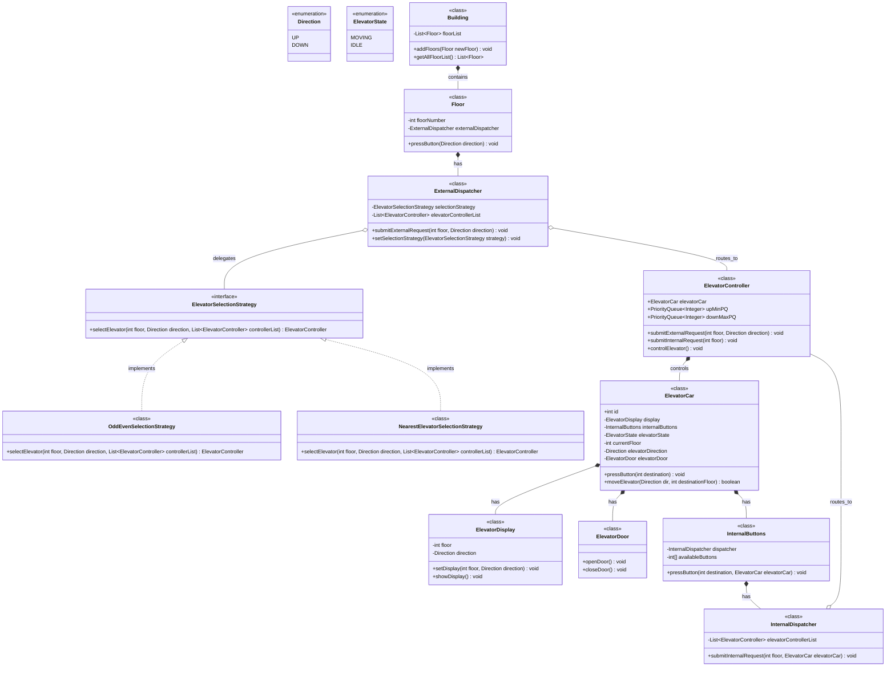

# Elevator Design System - Low Level Design & Architecture

## 1. System Overview
The **Elevator System** coordinates multi-car vertical transportation across floors in a building. It separates:
- **Hall Calls (External Dispatcher)**: Passengers on floors request service (UP/DOWN). The system selects the best elevator using a pluggable **Strategy Pattern**.
- **Car Calls (Internal Dispatcher)**: Passengers inside the elevator select destination floors.
- **Motion Scheduling**: Each elevator is controlled by an `ElevatorController` maintaining directional priority queues (**Min-Heap** for UP and **Max-Heap** for DOWN) to optimize the SCAN/LOOK elevator algorithm.

---

## 2. Complete Visual Box-and-Wire Architecture Diagram

```
+========================================================================================================================+
|                                        ELEVATOR SYSTEM FULL CLASS & INTERACTION DIAGRAM                                |
+========================================================================================================================+

                                            [ BUILDING TOPOLOGY ]
                                           +------------------------------------+
                                           | Building                           |
                                           +------------------------------------+
                                           | - floorList: List<Floor>           |
                                           +------------------------------------+
                                           | + getAllFloorList(): List<Floor>   |
                                           +------------------------------------+
                                                             |
                                                             | 1..* (HAS-A Composition)
                                                             v
    [ PASSENGER HALL CALL ]                +------------------------------------+
              |                            | Floor                              |
              | presses button             +------------------------------------+
              v                            | - floorNumber: int                 |
    +-------------------+                  | - externalDispatcher: ExtDispatcher|
    | pressButton(UP)   |----------------->+------------------------------------+
    +-------------------+                  | + pressButton(dir: Direction): void|
                                           +------------------------------------+
                                                             |
                                                             | HAS-A (Composition)
                                                             v
+========================================================================================================================+
| 1. EXTERNAL DISPATCH & STRATEGY SUBSYSTEM (IS-A & HAS-A)                                                               |
+========================================================================================================================+

                   +-------------------------------------------------------------+
                   | ExternalDispatcher                                          |
                   +-------------------------------------------------------------+
                   | - selectionStrategy: ElevatorSelectionStrategy              |
                   | - elevatorControllerList: List<ElevatorController>          |
                   +-------------------------------------------------------------+
                   | + submitExternalRequest(floor: int, dir: Direction): void   |
                   | + setSelectionStrategy(strategy: Strategy): void            |
                   +-------------------------------------------------------------+
                                      |                               |
                                      | HAS-A (Delegates to Strategy) | HAS-A (Routes call)
                                      v                               v
             +----------------------------------------------------+   |
             | <<interface>>                                      |   |
             | ElevatorSelectionStrategy                          |   |
             +----------------------------------------------------+   |
             | + selectElevator(floor: int, dir: Direction,       |   |
             |   controllers: List<ElevatorController>): ElevatorCtrl |
             +----------------------------------------------------+   |
                               ▲                        ▲             |
                               |                        |             |
           . - - - - - - - - - +                        |             |
           : implements (IS-A)                          : implements (IS-A)
           v                                            v             |
+--------------------------------------+  +-------------------------+ |
| OddEvenSelectionStrategy             |  | NearestElevatorStrategy | |
+--------------------------------------+  +-------------------------+ |
| [@Override]                          |  | [@Override]             | |
| + selectElevator(floor, dir, list):  |  | + selectElevator(...)   | |
|   ElevatorController                 |  |                         | |
+--------------------------------------+  +-------------------------+ |
(Odd floors -> Odd Car, Even -> Even)       (Minimizes seek distance) |
                                                                      |
                                                                      v
+========================================================================================================================+
| 2. CONTROLLER & MOTION SCHEDULING SUBSYSTEM (SCAN/LOOK HEAPS)                                                          |
+========================================================================================================================+

                               +---------------------------------------------------------+
                               | ElevatorController                                      |
                               +---------------------------------------------------------+
                               | + elevatorCar: ElevatorCar                              |
                               | + upMinPQ: PriorityQueue<Integer>     (Min-Heap for UP) |
                               | + downMaxPQ: PriorityQueue<Integer>   (Max-Heap for DN) |
                               +---------------------------------------------------------+
                               | + submitExternalRequest(floor: int, dir: Dir): void     |
                               | + submitInternalRequest(floor: int): void               |
                               | + controlElevator(): void (Executes SCAN motion stops)  |
                               +---------------------------------------------------------+
                                                             |
                                                             | 1:1 HAS-A (Controls Car)
                                                             v
+========================================================================================================================+
| 3. PHYSICAL ELEVATOR CAR & CABIN HARDWARE SUBSYSTEM                                                                    |
+========================================================================================================================+

                               +---------------------------------------------------------+
                               | ElevatorCar                                             |
                               +---------------------------------------------------------+
                               | + id: int                                               |
                               | - currentFloor: int                                     |
                               | - elevatorDirection: Direction        [UP / DOWN]       |
                               | - elevatorState: ElevatorState        [IDLE / MOVING]   |
                               | - display: ElevatorDisplay                              |
                               | - elevatorDoor: ElevatorDoor                            |
                               | - internalButtons: InternalButtons                      |
                               +---------------------------------------------------------+
                               | + pressButton(destinationFloor: int): void              |
                               | + moveElevator(dir: Direction, targetFloor: int): bool  |
                               | + showDisplay(): void                                   |
                               +---------------------------------------------------------+
                                       |                    |                    |
                 +---------------------+                    |                    +---------------------+
                 | HAS-A                                    | HAS-A                                    | HAS-A
                 v                                          v                                          v
+---------------------------------+        +---------------------------------+        +---------------------------------+
| ElevatorDisplay                 |        | ElevatorDoor                    |        | InternalButtons                 |
+---------------------------------+        +---------------------------------+        +---------------------------------+
| - floor: int                    |        | + openDoor(): void              |        | - availableButtons: int[]       |
| - direction: Direction          |        | + closeDoor(): void             |        | - dispatcher: InternalDispatcher|
+---------------------------------+        +---------------------------------+        +---------------------------------+
| + setDisplay(floor, dir): void  |                                                   | + pressButton(dest, car): void  |
| + showDisplay(): void           |                                                   +---------------------------------+
+---------------------------------+                                                                    |
                                                                                                       | HAS-A
                                                                                                       v
                                                                                      +---------------------------------+
                                                                                      | InternalDispatcher              |
                                                                                      +---------------------------------+
                                                                                      | - controllers: List<ElevatorCtrl>|
                                                                                      +---------------------------------+
                                                                                      | + submitInternalRequest(dest,   |
                                                                                      |   car: ElevatorCar): void       |
                                                                                      +---------------------------------+
                                                                                                       |
                                                                                                       | routes destination to
                                                                                                       +---> ElevatorController.upMinPQ
                                                                                                             ElevatorController.downMaxPQ
```

---

## 3. Mermaid UML Class Diagram (Strict Renderer Syntax)



---

## 4. IS-A and HAS-A Relationship Details

### A. IS-A (Realization & Inheritance)
| Implementing Class | Interface / Superclass | Relationship | Method Overridden & Contract |
|---|---|---|---|
| `OddEvenSelectionStrategy` | `ElevatorSelectionStrategy` | **Realization (`implements`)** | `@Override selectElevator(int floor, Direction direction, List<ElevatorController> list)`: Filters elevators based on matching odd/even floor and car IDs. |
| `NearestElevatorSelectionStrategy` | `ElevatorSelectionStrategy` | **Realization (`implements`)** | `@Override selectElevator(int floor, Direction direction, List<ElevatorController> list)`: Calculates minimum distance `|currentFloor - floor|` prioritizing elevators already moving in requested direction. |

### B. HAS-A (Composition & Aggregation)
| Owner Class | Owned / Referenced Component | Multiplicity | Association Type | Purpose |
|---|---|---|---|---|
| `Building` | `Floor` | `1..*` | **Composition (`*--`)** | Building owns and lifecycle-manages floors. |
| `Building` | `ElevatorController` | `1..*` | **Composition (`*--`)** | Building owns the elevator cars and their controllers (building-level asset). |
| `Floor` | `ExternalDispatcher` | `1` | **Aggregation (`o--`)** | Floor references a shared or injected ExternalDispatcher to broadcast hall calls. |
| `ExternalDispatcher` | `ElevatorSelectionStrategy` | `1` | **Aggregation (`o--`)** | Strategy injected to dynamically choose an elevator. |
| `ExternalDispatcher` | `ElevatorController` | `1..*` | **Aggregation / Shared Ref (`o--`)** | Shared reference to the building's controllers (all floors see the SAME controllers). |
| `ElevatorCar` | `ElevatorDisplay` | `1` | **Composition (`*--`)** | Display physically mounted on car. |
| `ElevatorCar` | `ElevatorDoor` | `1` | **Composition (`*--`)** | Physical motorized door attached to car. |
| `ElevatorCar` | `InternalButtons` | `1` | **Composition (`*--`)** | Keypad panel inside elevator car. |
| `ElevatorCar` | `Direction` | `1` | **Association (`-->`)** | Tracks current movement direction (`UP`, `DOWN`). |
| `ElevatorCar` | `ElevatorState` | `1` | **Association (`-->`)** | Tracks operating state (`MOVING`, `IDLE`). |
| `InternalButtons` | `InternalDispatcher` | `1` | **Composition (`*--`)** | Keypad delegates button presses to internal dispatcher. |
| `InternalDispatcher` | `ElevatorController` | `1..*` | **Aggregation (`o--`)** | Routes internal destination requests to elevator controllers. |
| `ElevatorController` | `ElevatorCar` | `1` | **Composition (`*--`)** | Dedicated 1:1 controller managing physical elevator car. |
| `ElevatorController` | `PriorityQueue<Integer>` | `2` | **Composition (`*--`)** | `upMinPQ` (Min-Heap) and `downMaxPQ` (Max-Heap) for stops. |

---

## 5. Design Patterns Deep Dive & Mapping

### 1. Strategy Pattern
- **Used In**: Elevator Selection Algorithm (`ElevatorSelectionStrategy`).
- **Participants**:
  - **Strategy Interface**: `ElevatorSelectionStrategy` defining `selectElevator(...)`.
  - **Concrete Strategies**: `OddEvenSelectionStrategy` (simplistic even/odd routing), `NearestElevatorSelectionStrategy` (seek distance optimization).
  - **Context**: `ExternalDispatcher` holds reference to `ElevatorSelectionStrategy` via composition.
- **Why It's Used**: Decouples the hall call handling from the elevator dispatch algorithm. Allows switching between odd/even, shortest-seek, or LOOK/SCAN strategies without modifying `Floor` or `ExternalDispatcher`.

### 2. Dispatcher Pattern (Mediator / Router)
- **Used In**: `ExternalDispatcher` and `InternalDispatcher`.
- **Participants**:
  - `ExternalDispatcher`: Mediates between `Floor` (hall call buttons) and the pool of `ElevatorController` instances.
  - `InternalDispatcher`: Mediates between `InternalButtons` (inside car) and the elevator's controller.
- **Why It's Used**: Prevents tight coupling between `Floor` and specific `ElevatorCar` instances. `Floor` does not need to know which elevators exist or how they are scheduled.

### 3. Min/Max Priority Queue Scheduling (SCAN / LOOK Elevator Algorithm)
- **Used In**: `ElevatorController`.
- **Participants**:
  - `upMinPQ` (`PriorityQueue<Integer>`): Natural ascending order min-heap. When the elevator travels UP, it serves floors in ascending order without jumping back.
  - `downMaxPQ` (`PriorityQueue<Integer>` with `(a, b) -> b - a`): Descending order max-heap. When the elevator travels DOWN, it serves floors in descending order.
- **Why It's Used**: Minimizes elevator seek time and prevents thrashing (moving up and down erratically). Matches real-world elevator disk-scheduling (SCAN algorithm).

### 4. Controller Pattern (Context / Hardware Manager)
- **Used In**: `ElevatorController` managing `ElevatorCar`.
- **Participants**:
  - `ElevatorController`: Worker thread/engine loop checking request queues, commanding door states (`openDoor`, `closeDoor`), updating display, and incrementing floors.
  - `ElevatorCar`: Passive hardware model exposing state, sensors, and actuators.
- **Why It's Used**: Single Responsibility Principle (SRP) — keeps physical attributes (weight capacity, current floor, display) separate from control logic (queuing, algorithms, motion loops).

### 5. Factory / Creator Pattern
- **Used In**: `ElevatorCreator`.
- **Participants**:
  - `ElevatorCreator`: Factory helper initializing `ElevatorCar` and `ElevatorController` instances and pooling them in `elevatorControllerList`.
- **Why It's Used**: Centralizes creation and wiring of hardware components before simulation starts.

---

## 6. Architectural Relationship Deep Dive: Controller Sharing & Building Topology

### 6.1 The Core Question: Are Controllers Duplicated per Floor?
When looking at [ExternalDispatcher.java](file:///c:/Users/meher/OneDrive/Desktop/src/main/java/com/conceptandcoding/LowLevelDesign/LLDElevatorDesign/ExternalDispatcher.java#L8-L9):
```java
List<ElevatorController> elevatorControllerList = ElevatorCreator.elevatorControllerList;
```
And [Floor.java](file:///c:/Users/meher/OneDrive/Desktop/src/main/java/com/conceptandcoding/LowLevelDesign/LLDElevatorDesign/Floor.java#L10):
```java
public Floor(int floorNumber){
    this.floorNumber = floorNumber;
    externalDispatcher = new ExternalDispatcher();
}
```
**Does every floor create its own list of elevators?**
- **In Memory (Runtime)**: **No, they share the same list.** In Java, `ElevatorCreator.elevatorControllerList` is a `static` list on heap. When each `Floor` creates a `new ExternalDispatcher()`, its `elevatorControllerList` field simply holds a **reference pointer** to the exact same shared list of controllers. Changes made by Floor 1 (e.g. queuing a request) are immediately visible to Floor 2.
- **Architecturally (Design Quality)**: **Having each floor instantiate its own dispatcher pointing to a global static list is a code smell.** Elevators are building-level assets, not floor-level assets.

---

### 6.2 The Clean Architectural Model: Building as the Aggregate Root

In clean Object-Oriented Design (and standard LLD interview expectations), elevator controllers belong at the **Building level**:

```
+====================================================================================================+
|                                    CLEAN TOPOLOGY: BUILDING AGGREGATE ROOT                         |
+====================================================================================================+

                                      +------------------------------------+
                                      | Building                           |
                                      +------------------------------------+
                                      | - floorList: List<Floor>           |
                                      | - elevatorControllers: List<Ctrl>  | <--- OWNS ELEVATORS
                                      | - externalDispatcher: ExtDispatcher| <--- SHARED DISPATCHER
                                      +------------------------------------+
                                             |                      |
                    1..* HAS-A (Composition) |                      | 1..* HAS-A (Composition)
                                             v                      v
                             +-------------------+     +-------------------------+
                             | Floor             |     | ElevatorController      |
                             +-------------------+     +-------------------------+
                             | - floorNumber: int|     | - elevatorCar: Car      |
                             +-------------------+     | - upMinPQ / downMaxPQ   |
                                     |                 +-------------------------+
                                     |                             ^
                                     | delegates hall call         | routes to shared
                                     v                             | controllers
                             +-------------------------------------+
                             | Shared ExternalDispatcher           |
                             +-------------------------------------+
                             | - selectionStrategy: Strategy       |
                             | - controllers: List<ElevatorCtrl>   |
                             +-------------------------------------+
```

#### Why Elevators Must Be at the Building Level:
1. **Single Source of Truth**:
   The elevators move across multiple floors. To know where an elevator is (current floor, direction, queue length), all floors must query the **same coordinated controller instances**.
2. **Multi-Building Support**:
   If your system models a corporate campus with `Building A` and `Building B`, each building must have its own bank of elevators. Using global `static` lists breaks multi-building support because all buildings would mistakenly share the same elevators.
3. **Dependency Injection**:
   Rather than each `Floor` blindly doing `new ExternalDispatcher()` with static lookups, `Building` creates a single shared `ExternalDispatcher` and injects it into each `Floor`:
   ```java
   // Clean Dependency Injection:
   public class Building {
       List<Floor> floors;
       List<ElevatorController> controllers;
       ExternalDispatcher externalDispatcher;

       public Building(int numFloors, List<ElevatorController> controllers) {
           this.controllers = controllers;
           this.externalDispatcher = new ExternalDispatcher(controllers, new NearestElevatorSelectionStrategy());
           this.floors = new ArrayList<>();
           for (int i = 1; i <= numFloors; i++) {
               floors.add(new Floor(i, this.externalDispatcher)); // All floors share ONE dispatcher
           }
       }
   }
   ```

---

### 6.3 Relationship Summary Matrix

| Approach | Where Controllers Live | How Floors Access Them | Pros & Cons |
|---|---|---|---|
| **Starter Code (Static Pool)** | `ElevatorCreator` (`static List`) | Each `Floor` does `new ExternalDispatcher()` reading static list | Quick to write for simple demo; tightly coupled to static class; fails for multiple buildings. |
| **Recommended LLD (Building Aggregate)** | `Building` (`List<ElevatorController>`) | `Building` injects shared `ExternalDispatcher` into each `Floor` | **Production standard**: Clean lifecycle, zero static leakage, single source of truth, testable. |

