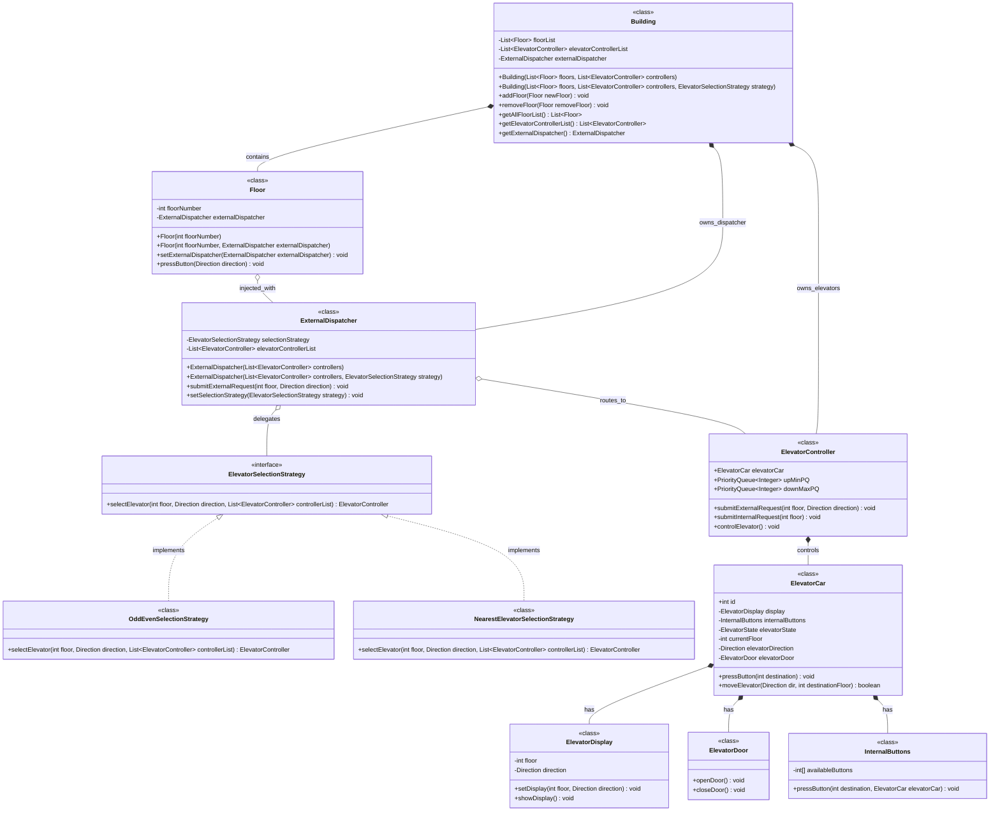

# Elevator Design System - Low Level Design & Architecture

## 1. System Overview (Clean Architecture: Building Aggregate Root)
The **Elevator System** coordinates multi-car vertical transportation across floors in a building. Under **Clean Architecture**:
- **Building is the Aggregate Root**: `Building` directly composes and owns both `List<Floor>` and `List<ElevatorController>`. Elevators are building-level assets, providing a single source of truth across all floors.
- **Dependency Injection**: `Building` initializes a single shared `ExternalDispatcher` and injects it into each `Floor`. All floors share the exact same controller instances in memory.
- **Pluggable Selection (Strategy Pattern)**: Hall calls (UP/DOWN) are delegated to `ElevatorSelectionStrategy` (`NearestElevatorSelectionStrategy`, `OddEvenSelectionStrategy`) to choose the optimal elevator car.
- **Directional SCAN Scheduling**: Each `ElevatorController` maintains `upMinPQ` (Min-Heap for UP stops) and `downMaxPQ` (Max-Heap for DOWN stops) to eliminate elevator thrashing.

---

## 2. Complete Visual Box-and-Wire Architecture Diagram

```
+========================================================================================================================+
|                                        ELEVATOR SYSTEM FULL CLASS & INTERACTION DIAGRAM                                |
|                                       (CLEAN ARCHITECTURE: BUILDING AS AGGREGATE ROOT)                                 |
+========================================================================================================================+

                                            +----------------------------------------------------+
                                            | Building (Aggregate Root)                          |
                                            +----------------------------------------------------+
                                            | - floorList: List<Floor>                           |
                                            | - elevatorControllerList: List<ElevatorController> | <--- OWNS ELEVATORS
                                            | - externalDispatcher: ExternalDispatcher           | <--- OWNS DISPATCHER
                                            +----------------------------------------------------+
                                            | + getAllFloorList(): List<Floor>                   |
                                            | + getElevatorControllerList(): List<ElevatorCtrl>  |
                                            | + getExternalDispatcher(): ExternalDispatcher      |
                                            | + addFloor(Floor): void                            |
                                            +----------------------------------------------------+
                                                    |                     |               |
               1..* HAS-A (Composition)            |                     |               | 1..* HAS-A (Composition)
               +-----------------------------------+                     |               +-----------------------+
               |                                                         | 1:1 HAS-A                             |
               v                                                         v                                       v
+------------------------------------+                 +------------------------------------+  +-------------------------+
| Floor                              |                 | ExternalDispatcher                 |  | ElevatorController      |
+------------------------------------+                 +------------------------------------+  +-------------------------+
| - floorNumber: int                 |                 | - selectionStrategy: Strategy      |  | + elevatorCar: Car      |
| - externalDispatcher: ExtDispatcher|                 | - controllers: List<ElevatorCtrl>  |  | + upMinPQ: Min-Heap     |
+------------------------------------+                 +------------------------------------+  | + downMaxPQ: Max-Heap   |
| + pressButton(dir: Direction): void|                 | + submitExternalRequest(...)       |  +-------------------------+
+------------------------------------+                 +------------------------------------+              |
               |                                                         |                                 |
               | uses shared injected dispatcher                         | delegates selection             | 1:1 HAS-A
               +-------------------------------------------------------->|                                 | (Controls car)
                                                                         v                                 v
                                                       +------------------------------------+  +-------------------------+
                                                       | <<interface>>                      |  | ElevatorCar             |
                                                       | ElevatorSelectionStrategy          |  +-------------------------+
                                                       +------------------------------------+  | + id: int               |
                                                       | + selectElevator(...): ElevatorCtrl|  | - currentFloor: int     |
                                                       +------------------------------------+  | - direction: Direction  |
                                                                  ▲               ▲            | - state: ElevatorState  |
                                                                  |               |            | - display: Display      |
                                              implements (IS-A)   |               |            | - door: ElevatorDoor    |
                                              +-------------------+               |            | - internalButtons: Btn  |
                                              |                                   |            +-------------------------+
                               +------------------------------+     +------------------------+             |
                               | OddEvenSelectionStrategy     |     | NearestElevatorStrategy|             | composes
                               +------------------------------+     +------------------------+             v
                               | [@Override]                  |     | [@Override]            |  +-------------------------+
                               | + selectElevator(...)        |     | + selectElevator(...)  |  | InternalButtons         |
                               +------------------------------+     +------------------------+  +-------------------------+
                                                                                                | - dispatcher: IntDisp   |
                                                                                                +-------------------------+
                                                                                                           |
                                                                                                           | routes to car's
                                                                                                           v controller
                                                                                                +-------------------------+
                                                                                                | InternalDispatcher      |
                                                                                                +-------------------------+
                                                                                                | + submitInternalRequest |
                                                                                                +-------------------------+
```

---

## 2b. Component Overview (What Each Class Physically Represents)

`
+-------------------------------------------------------------+
| Building (The physical skyscraper)                          |
| - Owns all floors AND all elevators (building-level asset)  |
| - Injects shared ExternalDispatcher into every floor        |
+-------------------------------------------------------------+
        |                                        |
        v                                        v
+---------------------------+    +-------------------------------+
| Floor (A physical level)  |    | ElevatorController            |
| - Has hall call buttons   |    | (The server/brain in the      |
|   (UP / DOWN panel)       |    |  motor room)                  |
| - References shared       |    | - Controls motor              |
|   ExternalDispatcher      |    | - upMinPQ (Min-Heap for UP)   |
+---------------------------+    | - downMaxPQ (Max-Heap for DN) |
        |                        | - SCAN scheduling algorithm   |
        v hall call              +-------------------------------+
+---------------------------+                 |
| ExternalDispatcher        |                 | 1:1 owns
| (The building intercom /  |                 v
|  dispatch desk)           |    +-------------------------------+
| - Picks best elevator via |    | ElevatorCar                   |
|   ElevatorSelectionStrategy    | (The physical cabin)          |
| - Routes to controller    |    | - currentFloor, direction     |
+---------------------------+    | - ElevatorDisplay (screen)    |
                                 | - ElevatorDoor (motor door)   |
                                 | - InternalButtons (keypad)    |
                                 +-------------------------------+
                                              |
                                              v composes
                            +------------------------------------+
                            | InternalButtons                    |
                            | (The brass/plastic keypad inside)  |
                            | - availableButtons = {1..10}       |
                            | - Validates destination floor      |
                            | - Directly signals car controller: |
                            |   car.getElevatorController()      |
                            |   .submitInternalRequest(dest)     |
                            +------------------------------------+
`

> [!NOTE]
> InternalDispatcher has been **removed**. Previously it was an extra middleman between
> InternalButtons and ElevatorController. Since each ElevatorCar has a 1:1 relationship
> with its controller, InternalButtons now calls the controller directly — simpler, cleaner, no circular dependency.

---

## 3. Mermaid UML Class Diagram (Strict Renderer Syntax)



---

## 4. IS-A and HAS-A Relationship Details

### A. IS-A (Realization & Inheritance)
| Implementing Class | Interface / Superclass | Relationship | Method Overridden & Contract |
|---|---|---|---|
| `OddEvenSelectionStrategy` | `ElevatorSelectionStrategy` | **Realization (`implements`)** | `@Override selectElevator(int floor, Direction direction, List<ElevatorController> list)`: Filters elevators based on matching odd/even floor and car IDs. |
| `NearestElevatorSelectionStrategy` | `ElevatorSelectionStrategy` | **Realization (`implements`)** | `@Override selectElevator(int floor, Direction direction, List<ElevatorController> list)`: Calculates minimum distance `|currentFloor - floor|` prioritizing elevators already moving in requested direction. |

### B. HAS-A (Composition & Aggregation)
| Owner Class | Owned / Referenced Component | Multiplicity | Association Type | Purpose |
|---|---|---|---|---|
| `Building` | `Floor` | `1..*` | **Composition (`*--`)** | Building owns and lifecycle-manages floors. |
| `Building` | `ElevatorController` | `1..*` | **Composition (`*--`)** | Building owns the elevator cars and their controllers (building-level asset). |
| `Building` | `ExternalDispatcher` | `1` | **Composition (`*--`)** | Building initializes and owns the shared external hall call dispatcher. |
| `Floor` | `ExternalDispatcher` | `1` | **Aggregation / DI (`o--`)** | Floor references the injected building-level ExternalDispatcher. |
| `ExternalDispatcher` | `ElevatorSelectionStrategy` | `1` | **Aggregation (`o--`)** | Strategy injected to dynamically choose an elevator. |
| `ExternalDispatcher` | `ElevatorController` | `1..*` | **Aggregation / Shared Ref (`o--`)** | References building's controllers (all floors see the SAME controllers). |
| `ElevatorCar` | `ElevatorDisplay` | `1` | **Composition (`*--`)** | Display physically mounted on car. |
| `ElevatorCar` | `ElevatorDoor` | `1` | **Composition (`*--`)** | Physical motorized door attached to car. |
| `ElevatorCar` | `InternalButtons` | `1` | **Composition (`*--`)** | Keypad panel inside elevator car. |
| `ElevatorCar` | `Direction` | `1` | **Association (`-->`)** | Tracks current movement direction (`UP`, `DOWN`). |
| `ElevatorCar` | `ElevatorState` | `1` | **Association (`-->`)** | Tracks operating state (`MOVING`, `IDLE`). |
| `InternalButtons` | `InternalDispatcher` | `1` | **Composition (`*--`)** | Keypad delegates button presses to internal dispatcher. |
| `InternalDispatcher` | `ElevatorController` | `1..*` | **Aggregation (`o--`)** | Routes internal destination requests to the car's controller. |
| `ElevatorController` | `ElevatorCar` | `1` | **Composition (`*--`)** | Dedicated 1:1 controller managing physical elevator car. |
| `ElevatorController` | `PriorityQueue<Integer>` | `2` | **Composition (`*--`)** | `upMinPQ` (Min-Heap) and `downMaxPQ` (Max-Heap) for stops. |

---

## 5. Design Patterns Deep Dive & Mapping

### 1. Building as Aggregate Root & Dependency Injection (Clean Architecture)
- **Used In**: `Building` coordinating `Floor`, `ElevatorController`, and `ExternalDispatcher`.
- **Why It's Used**: Establishes a clear ownership hierarchy. Elevators belong to the `Building`. The `Building` passes the shared `ExternalDispatcher` into each `Floor`. No static state leakage, supporting multiple buildings and clean unit testing.

### 2. Strategy Pattern
- **Used In**: Elevator Selection Algorithm (`ElevatorSelectionStrategy`).
- **Participants**:
  - **Strategy Interface**: `ElevatorSelectionStrategy` defining `selectElevator(...)`.
  - **Concrete Strategies**: `OddEvenSelectionStrategy`, `NearestElevatorSelectionStrategy`.
  - **Context**: `ExternalDispatcher` holds reference to `ElevatorSelectionStrategy` via composition.
- **Why It's Used**: Decouples the hall call handling from the elevator dispatch algorithm. Allows switching between odd/even, shortest-seek, or LOOK/SCAN strategies without modifying `Floor` or `ExternalDispatcher`.

### 3. Dispatcher Pattern (Mediator / Router)
- **Used In**: `ExternalDispatcher` and `InternalDispatcher`.
- **Participants**:
  - `ExternalDispatcher`: Mediates between `Floor` (hall call buttons) and the pool of `ElevatorController` instances.
  - `InternalDispatcher`: Mediates between `InternalButtons` (inside car) and the elevator's controller.
- **Why It's Used**: Prevents tight coupling between `Floor` and specific `ElevatorCar` instances. `Floor` does not need to know which elevators exist or how they are scheduled.

### 4. Min/Max Priority Queue Scheduling (SCAN / LOOK Elevator Algorithm)
- **Used In**: `ElevatorController`.
- **Participants**:
  - `upMinPQ` (`PriorityQueue<Integer>`): Natural ascending order min-heap. When the elevator travels UP, it serves floors in ascending order without jumping back.
  - `downMaxPQ` (`PriorityQueue<Integer>` with `(a, b) -> b - a`): Descending order max-heap. When the elevator travels DOWN, it serves floors in descending order.
- **Why It's Used**: Minimizes elevator seek time and prevents thrashing (moving up and down erratically). Matches real-world elevator disk-scheduling (SCAN algorithm).

### 5. Controller Pattern (Context / Hardware Manager)
- **Used In**: `ElevatorController` managing `ElevatorCar`.
- **Participants**:
  - `ElevatorController`: Worker thread/engine loop checking request queues, commanding door states (`openDoor`, `closeDoor`), updating display, and incrementing floors.
  - `ElevatorCar`: Passive hardware model exposing state, sensors, and actuators.
- **Why It's Used**: Single Responsibility Principle (SRP) — keeps physical attributes (weight capacity, current floor, display) separate from control logic (queuing, algorithms, motion loops).

---

## 6. Architectural Relationship Deep Dive: Controller Sharing & Building Topology

### 6.1 Why Controllers Belong at Building Level
In our refactored Clean Architecture:
```java
// 1. Setup floors
List<Floor> floors = List.of(new Floor(1), new Floor(2), new Floor(3), new Floor(4), new Floor(5));

// 2. Setup elevator bank
List<ElevatorController> controllers = ElevatorCreator.createElevatorControllers(2);

// 3. Building owns both and injects the shared ExternalDispatcher
Building building = new Building(floors, controllers, new NearestElevatorSelectionStrategy());
```
1. **Single Source of Truth**: Elevators move across floors; all floors must access the identical controller instances to know current car floors, directions, and queues.
2. **Multi-Building Support**: A campus with `Tower A` and `Tower B` creates separate `Building` instances with independent elevator banks, with zero static collision.
3. **True Dependency Injection**: `Floor` never creates a new dispatcher or reaches into global static state; `Building` injects the shared dispatcher into each floor upon building assembly.
