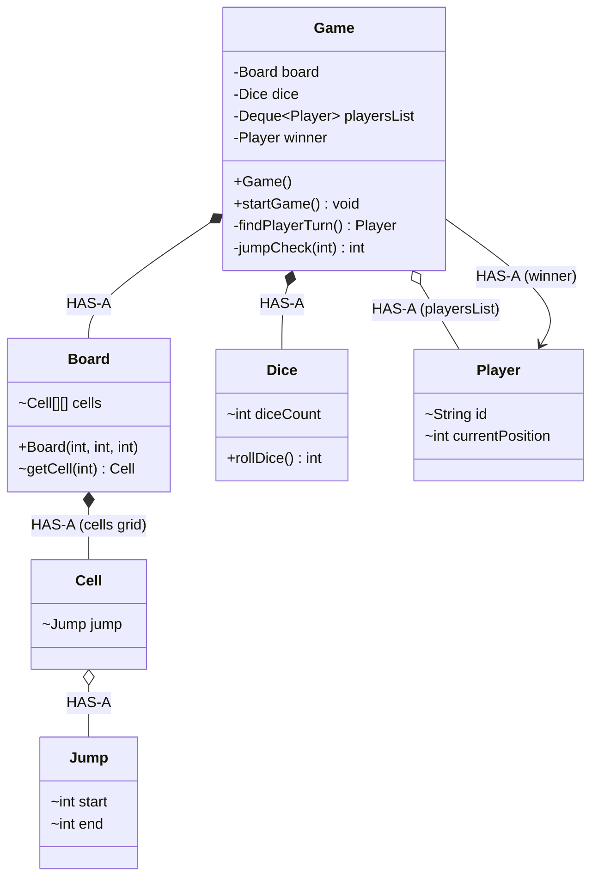

# Snake and Ladder Game - Low Level Design & Architecture

## 1. Overview
Multiplayer board game where players roll dice and advance through numbered cells containing snakes and ladders.

---

## 2. Design Patterns Used
1. **Facade Pattern**:
   - `Game` acts as a facade managing dice rolling, turn rotations, jump checks, and victory validation.
2. **Unified Abstraction (`Jump`)**:
   - Eliminates need for separate `Snake` and `Ladder` classes by using a single `Jump` class with `start` and `end` indices.

---

## 3. Relationships Summary (IS-A & HAS-A)

### IS-A (Inheritance / Realization)
- Standalone POJO domain model without inheritance.

### HAS-A (Composition & Association)
- `Game` **HAS-A** `Board` (`board`)
- `Game` **HAS-A** `Dice` (`dice`)
- `Game` **HAS-A** `Deque<Player>` (`playersList`)
- `Game` **HAS-A** `Player` (`winner`)
- `Board` **HAS-A** `Cell[][]` (`cells`)
- `Cell` **HAS-A** `Jump` (`jump`)
- `Jump` has `start` and `end` cell integer positions.

---

## 4. Mermaid UML Class Diagram

