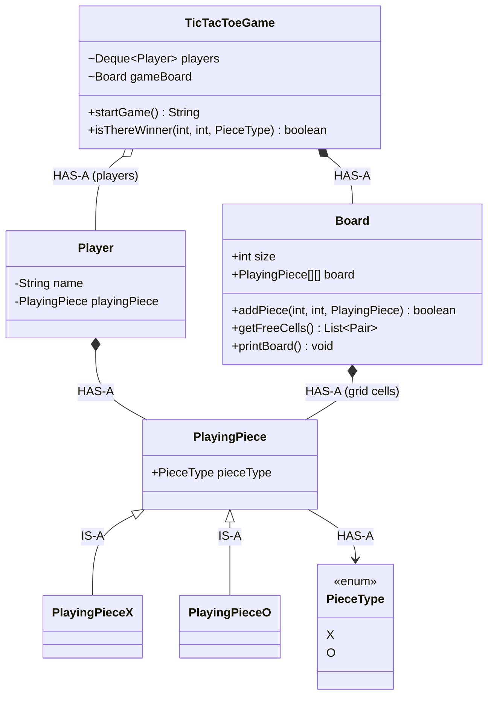

# Tic Tac Toe - Low Level Design & Architecture

## 1. Overview
$N \times N$ Tic Tac Toe board game modeling extensible token types, player turn management, and $O(N)$ winner checks.

---

## 2. Design Patterns Used
1. **Polymorphic Token Hierarchy (IS-A)**:
   - `PlayingPiece` abstract base class extended by `PlayingPieceX` and `PlayingPieceO`.
2. **Round-Robin Queue**:
   - `Deque<Player>` to rotate player moves in FIFO order.

---

## 3. Relationships Summary (IS-A & HAS-A)

### IS-A (Inheritance / Realization)
- `PlayingPieceX` **IS-A** `PlayingPiece` (`extends PlayingPiece`)
- `PlayingPieceO` **IS-A** `PlayingPiece` (`extends PlayingPiece`)

### HAS-A (Composition & Association)
- `TicTacToeGame` **HAS-A** `Board` (`gameBoard`)
- `TicTacToeGame` **HAS-A** `Deque<Player>` (`players`)
- `Board` **HAS-A** `PlayingPiece[][]` (`board`)
- `Player` **HAS-A** `PlayingPiece` (`playingPiece`)
- `PlayingPiece` **HAS-A** `PieceType` (`pieceType`)

---

## 4. Mermaid UML Class Diagram

